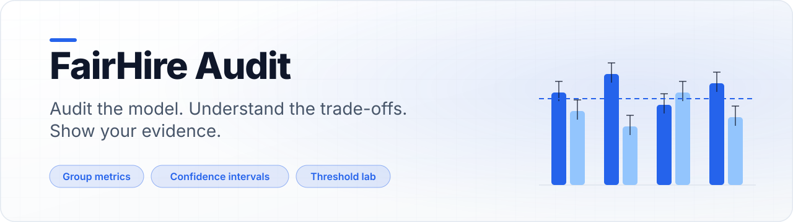
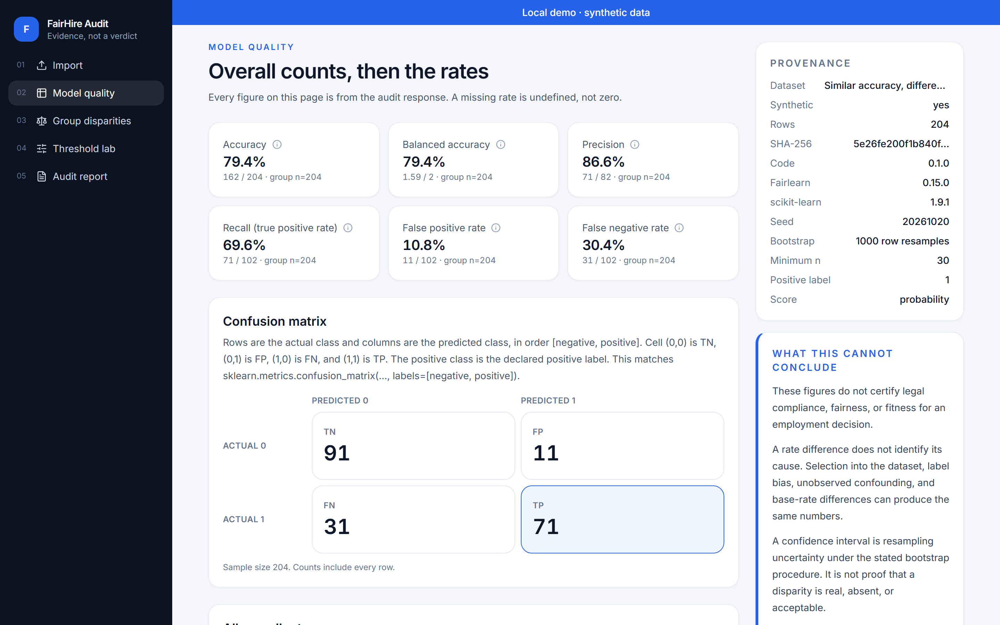
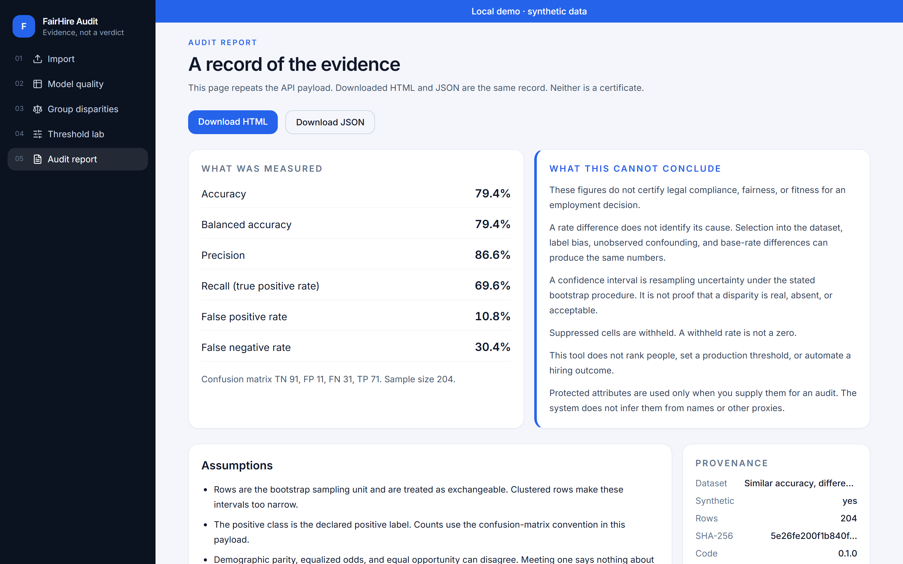
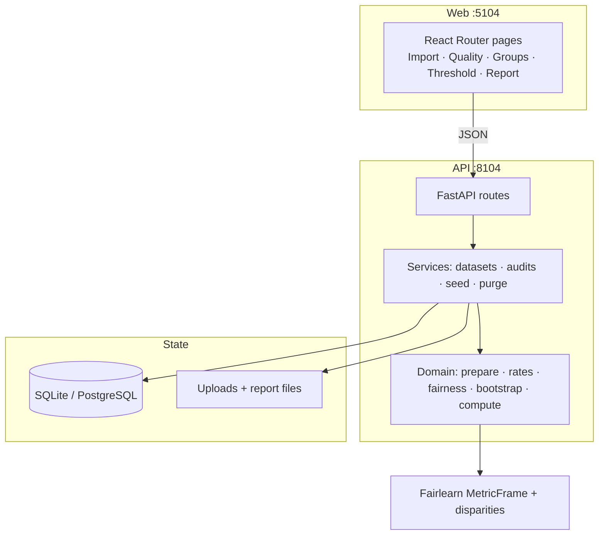
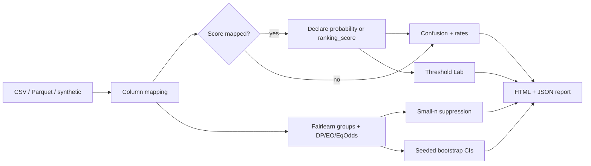

<a id="readme-top"></a>

<div align="center">

<picture>
  <source media="(prefers-color-scheme: dark)" srcset="docs/assets/banner-dark.svg">
  
</picture>

[](https://github.com/hasanhuseyinyetkiner/fairhire-audit/actions/workflows/ci.yml)

**Audit the model. Understand the trade-offs. Show your evidence.**

Hiring models can look fine on overall accuracy while group error rates diverge. FairHire Audit is a local workstation for inspecting evaluation tables — confusion matrices, Fairlearn disparities, sample-size flags, seeded bootstrap intervals, and a Threshold Lab that stays locked until score semantics are declared. It is an **audit tool**, not a hiring decision engine.

[Overview](#executive-overview) · [Demo](#product-demonstration) · [Architecture](#system-architecture) · [Deep dive](#engineering-deep-dive) · [Evidence](#evaluation-and-evidence) · [Quick start](#getting-started) · [Docs](#documentation)

</div>

<p align="center">
  <picture>
    <source media="(prefers-color-scheme: dark)" srcset="docs/screenshots/group-disparities-dark.png">
    
  </picture>
</p>

Accent: `#2563EB`. Captures from a live stack on API `:8104` and web `:5104` via `pnpm screenshots`.

---

## Executive overview

| Dimension | Description |
| --- | --- |
| Business challenge | Overall accuracy hides mismatched false-positive / false-negative rates across groups in hiring-model evaluation data. |
| Proposed solution | Transparent audit UI + API over labeled evaluation rows (`y_true`, `y_pred` or `score`, permitted group columns) with a fixed “cannot conclude” section. |
| Primary users | ML / people-analytics engineers and reviewers with authorized or synthetic evaluation extracts. |
| Engineering challenge | Correct rates under undefined denominators; Fairlearn-aligned disparities; honest uncertainty; FHA-1 score gate (ranking ≠ probability). |
| Architecture | React + Vite + TypeScript; FastAPI + SQLAlchemy; Fairlearn / NumPy / SciPy / sklearn; SQLite demo or Postgres (CI). |
| Validation | Golden hand counts, Fairlearn agreement tests, API integration, Vitest, Playwright import→report; see [`docs/METRICS.md`](docs/METRICS.md). |
| Project status | **Local demo MVP** — single-operator, loopback by default. Offline local ≠ multi-user secured. Not a multi-tenant production SaaS. |

---

## Product demonstration

End-to-end on the seeded synthetic profile **Similar accuracy, different error rates** (204 rows). Fixture values verified against `app/domain/synthetic.py` and `tests/test_golden.py`.

### Case study: input → quality → disparities → uncertainty → report

| Step | What you see | Verified numbers |
| --- | --- | --- |
| **1. Input** | Generate or open **Similar accuracy, different error rates**; map `y_true` / `y_pred` / `score` (probability) / `group` | 204 rows: `group_a` 100, `group_b` 100, `group_c` 4 |
| **2. Quality** | Overall confusion matrix with numerators, denominators, and *n* | TN **91**, FP **11**, FN **31**, TP **71** (accuracy ≈ 79.4%) |
| **3. Disparities** | Same accuracy, different error structure; tiny cell withheld | `group_a` / `group_b` accuracy 0.80 with FPR/FNR **0.20/0.20** vs **0.00/0.40**; `group_c` suppressed (min *n* = 30). DP / EO / EqOdds ≈ **0.20** on eligible groups only |
| **4. Uncertainty** | Seeded percentile bootstrap CIs on overall and eligible-group rates | Sampling unit = **row**; default *B* = 1000, seed `20261020`; intervals withheld below 50 finite replicates or for suppressed groups |
| **5. Report** | Download HTML + JSON | Measured metrics, assumptions, bootstrap provenance, **What this cannot conclude**. Neither file is a certificate |

Observing a disparity is **measurement**. It is not causation, compliance, certification, or a bias-free claim. Human review remains required before any employment-related action.

### Screenshots (quality → disparities → report)

<p align="center">
  <picture>
    <source media="(prefers-color-scheme: dark)" srcset="docs/screenshots/model-quality-dark.png">
    
  </picture>
</p>

<p align="center">
  <picture>
    <source media="(prefers-color-scheme: dark)" srcset="docs/screenshots/group-disparities-dark.png">
    
  </picture>
</p>

<p align="center">
  <picture>
    <source media="(prefers-color-scheme: dark)" srcset="docs/screenshots/audit-report-dark.png">
    
  </picture>
</p>

### 60-second path

1. Start API + web ([Getting started](#getting-started)); open http://127.0.0.1:5104.
2. **Import** → generate **Similar accuracy, different error rates** (or use the seeded dataset).
3. Map columns (prefilled; declare score as `probability` if using Threshold Lab) → **Run audit**.
4. **Model quality** (CM 91/11/31/71) → **Group disparities** (matched accuracy, diverging FPR/FNR, `group_c` amber) → read bootstrap CIs on the quality/groups views → **Audit report** → download HTML/JSON.

Playwright coverage: `frontend/e2e/workflow.spec.ts`.

---

## Problem and engineering approach

**Why simplistic alternatives fail**

| Shortcut | Failure mode |
| --- | --- |
| “Accuracy is 80% for everyone” | Same accuracy can hide opposite FPR/FNR trade-offs |
| Coerce undefined rates to 0 | Invents perfect precision/recall when denominators are empty |
| One fairness score | DP, EO, and EqOdds can disagree when base rates differ |
| Threshold slider on any numeric column | Treats ranking scores as probabilities |
| CI as a verdict | Confuses resampling uncertainty with causal or legal proof |

**Chosen approach.** Separate *measurement* from *conclusion*. Compute explicit confusion counts; dual-check group rates against Fairlearn; suppress tiny cells; bootstrap with a named sampling unit; gate Threshold Lab on declared score semantics; ship assumptions and cannot-conclude text in every report.

**Deliberately out of scope.** Causal attribution, protected-attribute inference, candidate ranking, automated reject/accept, and compliance certification.

---

## System architecture



| Component | Role |
| --- | --- |
| `app/domain/*` | Pure analysis (no HTTP) — golden-testable |
| `app/services/*` | Persistence, cascade delete, threadpool audit runs |
| `app/api.py` | Typed routes; `/health` stays responsive during bootstrap |
| Frontend | Multi-step audit UX with provenance + cannot-conclude panels |

Full write-up: [`docs/ARCHITECTURE.md`](docs/ARCHITECTURE.md). Frontend scripts: [`frontend/README.md`](frontend/README.md).

### Metrics pipeline



---

## Engineering deep dive

Five decisions that separate this from a metric dashboard. Full ADRs: [`docs/ENGINEERING_DECISIONS.md`](docs/ENGINEERING_DECISIONS.md).

### 1. Statistical assumptions (bootstrap)

Sampling unit = **row**; method = **percentile** (2.5 / 97.5); shared `numpy.random.Generator` per run; default *B* = 1000, seed `20261020`; withhold interval if fewer than 50 finite replicates. **Assumption:** rows are exchangeable. Clustered applicants make intervals too narrow. A CI is not proof of fairness.

### 2. Conflicting fairness criteria

Demographic parity, equal opportunity, and equalized odds are computed together. When one difference is ~0 and another is not, the run emits an explicit conflict warning. The synthetic “similar accuracy” profile is designed so overall quality looks fine while group FPR/FNR diverge.

### 3. Undefined ≠ zero; small-*n* ≠ zero

Zero denominators and groups below `FAIRHIRE_SMALL_GROUP_MIN_N` (default 30) return `null` + reason. Charts and disparities skip them; overall totals still include every row.

### 4. Fairlearn dual-check

Count-based rates for selection rate / TPR / FPR / FNR are asserted against `MetricFrame` on eligible groups. Disagreement fails the audit rather than shipping silent drift.

### 5. Threshold Lab score gate (FHA-1)

Lab opens only after `probability` (must lie in \[0, 1\]; Brier + reliability table as **descriptive** evidence) or `ranking_score`. The system never auto-labels a score “calibrated.”

---

## Evaluation and evidence

### Model-card summary

| | |
| --- | --- |
| **Intended use** | Audit evaluation tables for hiring classifiers |
| **Evaluation data** | Deterministic synthetic profiles (no PII) |
| **Measures** | CM + rates; Fairlearn DP/EO/EqOdds differences; bootstrap CIs; threshold sensitivity after score declaration |
| **Does not conclude** | Compliance, causation, bias-free status, deployable cutoffs |

Full methodology: [`docs/MODEL_CARD.md`](docs/MODEL_CARD.md). Commands + pass/fail: [`docs/METRICS.md`](docs/METRICS.md).

### Verified locally (2026-10-20)

| Check | Result |
| --- | --- |
| `uv run ruff check app tests` | Pass |
| `uv run pytest -q` | **17 passed, 1 skipped** (Postgres marker without `TEST_DATABASE_URL`) |
| `pnpm lint` / `typecheck` / `test` / `build` | Pass (3 Vitest) |
| Playwright workflow | **1 passed** |
| Live CM spot-check | TP/TN/FP/FN = **71 / 91 / 11 / 31** |

```powershell
uv run ruff check app tests
uv run pytest -q
cd frontend
pnpm lint; pnpm typecheck; pnpm test; pnpm build
pnpm test:e2e
```

CI: `.github/workflows/ci.yml` (Postgres pytest, frontend build, `compose-smoke`).

---

## Engineering competencies demonstrated

| Competency | Evidence in this repo |
| --- | --- |
| Responsible ML / evaluation design | Measures vs cannot-conclude; no decision-engine paths; report provenance |
| Statistical method judgment | Bootstrap sampling unit, finite-replicate gate, small-*n* suppression |
| Algorithmic fairness literacy | Fairlearn DP/EO/EqOdds; conflict warning when criteria disagree |
| Correctness engineering | Hand-computed goldens; Fairlearn dual-check; undefined-rate tests |
| API + product architecture | Domain/service split; threadpool audits; cascade delete + retention |
| Security hygiene for sensitive data | Loopback bind default; upload caps; synthetic-only public demo |
| Verification culture | Ruff, pytest, Vitest, Playwright, documented METRICS |

---

## Getting started

**Prerequisites:** Python 3.12 (`uv`), Node 24 + pnpm. Native path verified on Windows 11. Docker is optional (CI `compose-smoke` only on machines without Docker).

```powershell
# API → http://127.0.0.1:8104
uv sync
uv run python -m app

# Web → http://127.0.0.1:5104  (second terminal)
cd frontend
pnpm install
pnpm dev
```

| Service | URL |
| --- | --- |
| Web | http://127.0.0.1:5104 |
| OpenAPI | http://127.0.0.1:8104/docs |
| Health / ready | http://127.0.0.1:8104/health · `/ready` |
| Compose Postgres (optional) | host port `5404` |

Copy [`.env.example`](.env.example) only for overrides. Defaults: `FAIRHIRE_APP_ENV=demo`, loopback bind, SQLite `./data/fairhire.db`, bootstrap seed `20261020`, `FAIRHIRE_SEED_DEMO=true`. Non-loopback bind requires `FAIRHIRE_ALLOW_NETWORK_BIND=true`.

### API (implemented)

| Method | Path |
| --- | --- |
| `GET` | `/health`, `/ready`, `/api/meta` |
| `GET` / `POST` | `/api/datasets`, `/api/datasets/synthetic` |
| `POST` | `/api/datasets/{id}/mapping`, `/api/audits` |
| `GET` | `/api/audits/{id}`, `/groups`, `/report.html`, `/report.json` |
| `POST` | `/api/audits/{id}/threshold-scenarios` |
| `DELETE` | `/api/datasets/{id}` (cascade) |

`GET /api/meta` returns `"decision_engine": false`.

### Troubleshooting

| Symptom | Check |
| --- | --- |
| Bind refused | Host not loopback without `FAIRHIRE_ALLOW_NETWORK_BIND` |
| Threshold Lab locked | Map a score and declare `probability` or `ranking_score` |
| Group card amber | *n* &lt; `FAIRHIRE_SMALL_GROUP_MIN_N` — expected suppression |
| Parquet upload fails | `pyarrow` must be installed (`uv sync`) |

---

## Security, privacy, and limitations

- **Demo data is synthetic.** Do not publish real evaluation extracts, DBs, or reports.
- Loopback by default; **no auth in MVP** — offline local demo is still a single-operator trust boundary, not a multi-user secured product.
- Dataset delete cascades to runs, metrics, intervals, scenarios, reports, and files.
- Retention: `FAIRHIRE_DATA_RETENTION_DAYS` (default 30) + age-based cleanup via `uv run python -m app.cli purge` (operator-scheduled; not a subject-access workflow).
- Fairness metrics may **conflict**; observational differences are not causal; passing selected metrics is **not** proof of fairness; results are **not** legal certification.
- Never claims: bias-free, compliant, certified, or fit for automated employment decisions.

Details: [`docs/SECURITY.md`](docs/SECURITY.md).

---

## Documentation

| Doc | Contents |
| --- | --- |
| [`docs/MODEL_CARD.md`](docs/MODEL_CARD.md) | Methodology: intended use, formulas, bootstrap, suppression, limits |
| [`docs/METRICS.md`](docs/METRICS.md) | Verified commands, golden fixture numbers |
| [`docs/ARCHITECTURE.md`](docs/ARCHITECTURE.md) | Runtime topology, layers, audit sequence |
| [`docs/ENGINEERING_DECISIONS.md`](docs/ENGINEERING_DECISIONS.md) | Statistical assumptions, Fairlearn dual-check, score gate, conflicts |
| [`docs/SECURITY.md`](docs/SECURITY.md) | Threat boundary, cascade delete, purge CLI |
| [`docs/RELEASE_READINESS.md`](docs/RELEASE_READINESS.md) | Pre-tag checklist |
| [`docs/GITHUB_METADATA.md`](docs/GITHUB_METADATA.md) | About blurb, topics, release notes |
| [`frontend/README.md`](frontend/README.md) | Web app scripts and routes |
| [`docs/REVIEW_AMENDMENTS.md`](docs/REVIEW_AMENDMENTS.md) | Binding design-review amendments (FHA-1…C-6) |
| [`docs/PRODUCT_SPEC.md`](docs/PRODUCT_SPEC.md) | Historical product brief (amendments + shipped docs override) |

### Capabilities

| Capability | Status |
| --- | --- |
| CSV / Parquet upload (size-capped; Parquet via `pyarrow`) | Shipped |
| Column mapping + FHA-1 score gate | Shipped |
| Overall quality + Fairlearn group rates + DP/EO/EqOdds | Shipped |
| Small-*n* suppression + seeded bootstrap CIs | Shipped |
| Threshold Lab + HTML/JSON report with cannot-conclude | Shipped |
| Intersection toggle (API + UI; cell cap 200) | Shipped |
| Cascade delete + retention purge | Shipped |
| Side-by-side two-model comparison UI | Planned (domain deltas exist; dedicated UI not shipped) |

License: pending owner decision.

<p align="right"><a href="#readme-top">↑ back to top</a></p>
