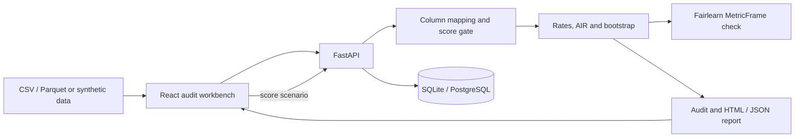

<a id="readme-top"></a>

<p align="center"></p>

# FairHire Audit

**See the differences behind an overall score.**

A local workstation for examining hiring-model evaluation tables: group rates, adverse impact ratios, uncertainty, and threshold scenarios in one auditable workflow.

[](https://github.com/hasanhuseyinyetkiner/fairhire-audit/actions/workflows/ci.yml)
[](LICENSE)

[Highlights](#highlights) · [Architecture](#architecture) · [Method](#method-and-evidence) · [Quick start](#quick-start) · [Testing](#testing) · [Limitations](#security-and-limitations) · [Docs](#documentation)

<p align="center">
  <picture>
    <source media="(prefers-color-scheme: dark)" srcset="docs/screenshots/group-disparities-dark.png">
    
  </picture>
</p>

*A synthetic example: equal group accuracy can conceal different false-positive and false-negative rates. The small group is withheld, not shown as zero.*

[Watch the real synthetic audit → group disparities → report workflow (GIF)](docs/assets/demo.gif). The screenshot above is a static alternative; regenerate the animation with `node scripts/record-demo.mjs` after installing the project dependencies, Playwright Chromium and FFmpeg. The isolated synthetic data and recording are retained in a temporary folder.

## Highlights

- **Start with observable counts.** Import CSV or Parquet, map evaluation columns, and inspect confusion counts, group rates, and Fairlearn disparities.
- **Examine selection differences.** Adverse impact ratios, 2×2 contingency tables, and Fisher exact tests provide context; the four-fifths flag is descriptive.
- **Keep uncertainty visible.** Seeded row-bootstrap intervals accompany audit metrics; small groups and undefined denominators are withheld with reasons.
- **Explore thresholds responsibly.** A declared probability or ranking score unlocks the Threshold Lab. Scenario results are point estimates, not deployed decisions or live confidence intervals.
- **Carry the context forward.** Export HTML or JSON reports with methodology and limits. See the captured [model quality](docs/screenshots/model-quality-light.png) and [audit report](docs/screenshots/audit-report-light.png) views; dark variants are in [`docs/screenshots/`](docs/screenshots/).

## Architecture



React, Vite, and TypeScript provide the interface; FastAPI and SQLAlchemy handle the API and persistence. SQLite is the local default; PostgreSQL is used in CI and Compose. The domain uses Fairlearn, NumPy, SciPy, and scikit-learn. See [architecture](docs/ARCHITECTURE.md) for the layers and invariants.

## Method and evidence

The audit computes group confusion counts and checks eligible group rates against Fairlearn `MetricFrame`. AIR divides a focal group's selection rate by the highest eligible group's rate. A zero denominator or a group below the minimum is reported as `null` with a reason; it is not silently converted to zero. The default minimum group size is 30.

Bootstrap intervals use row resampling and percentile bounds. They assume exchangeable rows; clustered observations can make intervals too narrow. The Threshold Lab recomputes point estimates only. Formulas, weighting, reference selection, and statistical assumptions are in the [model card](docs/MODEL_CARD.md); versioning and scenario scope are in [evaluation provenance](docs/EVALUATION.md).

The documented **204-row synthetic fixture** has overall TN / FP / FN / TP of **91 / 11 / 31 / 71**. Groups A and B each have 0.80 accuracy, while their false-negative rates are 0.20 and 0.40; group C has four rows and is suppressed. Group B's selection rate relative to A is approximately **0.60**. These are checks on a synthetic fixture, not evidence of fairness in a real hiring model. See [verified fixture results](docs/METRICS.md) and the machine-specific [performance baseline](docs/PERFORMANCE_BASELINE.md).

## Quick start

Prerequisites: Python 3.12 with `uv`, Node 24, and `pnpm`. From the repository root, start the API:

```powershell
uv sync
uv run python -m app
```

In a second terminal, from the repository root:

```powershell
cd frontend
pnpm install
pnpm dev
```

Open [the web app](http://127.0.0.1:5104) or [API documentation](http://127.0.0.1:8104/docs). The default API binds to loopback and uses SQLite at `./data/fairhire.db`; [`.env.example`](.env.example) documents overrides. Health and readiness are available at `/health` and `/ready` on port 8104.

To explore the fixture, choose **Import → Similar accuracy, different error rates**, map the columns, and declare the score as `probability`. Run the audit, compare **Model quality** and **Group disparities**, then move the **Threshold Lab** slider and export the report.

## Testing

From the repository root, in separate backend and frontend terminals:

```powershell
# Backend
uv run ruff check app tests
uv run pytest -q

# Frontend
cd frontend
pnpm lint
pnpm typecheck
pnpm test
pnpm build
pnpm exec playwright install chromium  # once
pnpm test:e2e
```

The [CI workflow](.github/workflows/ci.yml) includes PostgreSQL tests, Playwright and a Compose smoke job. [Recorded test results and fixture values](docs/METRICS.md) describe an earlier native run; `pnpm screenshots` in `frontend` regenerates the product captures. Compose requires Docker; the documented local smoke was blocked on a workstation without it.

## Security and limitations

This is a **local, single-operator MVP** with no authentication. It binds to loopback by default; do not load real protected-attribute HR extracts by default or publish them. Threshold scenarios do not approve or reject candidates. Observed disparities do not establish causation, and neither confidence intervals nor a four-fifths flag establish legal compliance or a bias-free model. CMH and a side-by-side two-model comparison UI are not implemented. See [security](docs/SECURITY.md) and [limitations](docs/LIMITATIONS.md).

## Documentation

- [Architecture and API](docs/ARCHITECTURE.md) · [Model card and formulas](docs/MODEL_CARD.md) · [Frontend](frontend/README.md)
- [Evaluation provenance](docs/EVALUATION.md) · [Fixture and test evidence](docs/METRICS.md) · [Performance baseline](docs/PERFORMANCE_BASELINE.md)
- [Security](docs/SECURITY.md) · [Limitations](docs/LIMITATIONS.md) · [Configuration](.env.example) · [MIT license](LICENSE)

<p align="right"><a href="#readme-top">Back to top ↑</a></p>
