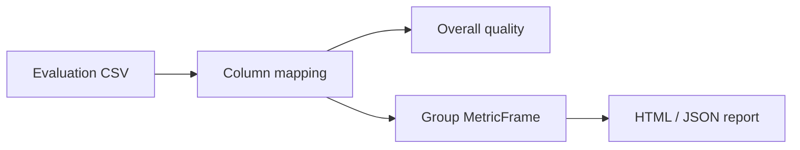

<a id="readme-top"></a>

<div align="center">

<picture>
  <source media="(prefers-color-scheme: dark)" srcset="docs/assets/banner-dark.svg">
  
</picture>

**Transparent audits for hiring ML models.** Confusion matrices, group disparity metrics (Fairlearn), sample-size flags, confidence intervals and a Threshold Lab that never pretends a score is calibrated unless you declare it.

[Quick start](#quick-start) · [How it works](#how-it-works) · [Limitations](#security-privacy-and-limitations)

</div>

## Quick start

```powershell
# Backend (API http://127.0.0.1:8104)
uv sync
uv run python -m app

# Frontend (http://127.0.0.1:5104) — new terminal
cd frontend
pnpm install
pnpm dev
```

| Service | URL |
| --- | --- |
| Web | http://127.0.0.1:5104 |
| API docs | http://127.0.0.1:8104/docs |

Synthetic evaluation datasets seed on startup. Flow: Import → Map columns → Model Quality → Group Disparities → Report.

## How it works



## Testing

```powershell
uv run pytest -q
cd frontend; pnpm test; pnpm build
```

## Security, privacy and limitations

> [!IMPORTANT]
> This is an audit tool, not a hiring decision engine. Synthetic data only. Metrics do not prove fairness or certify compliance.

License: pending owner decision.

<p align="right"><a href="#readme-top">↑ back to top</a></p>
