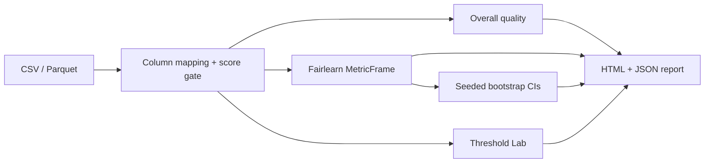

<a id="readme-top"></a>

<div align="center">

<picture>
  <source media="(prefers-color-scheme: dark)" srcset="docs/assets/banner-dark.svg">
  
</picture>

**Audit the model. Understand the trade-offs. Show your evidence.**

Transparent audits for hiring ML models: confusion matrices, Fairlearn group metrics, sample-size flags, seeded bootstrap confidence intervals, and a Threshold Lab that opens only when score semantics are declared.

[Quick start](#quick-start) · [How it works](#how-it-works) · [What this measures](#what-this-measures--vs--cannot-conclude) · [Verification](#verification) · [Limitations](#security-privacy-and-limitations)

</div>

## Quick start

Native path (verified on Windows 11 with `uv` + pnpm). Docker Compose is for CI smoke only until the `compose-smoke` job is green on GitHub Actions.

```powershell
# Backend (API http://127.0.0.1:8104)
uv sync
uv run python -m app

# Frontend (http://127.0.0.1:5104) — new terminal
cd frontend
pnpm install
pnpm dev
```

| Service | URL / port |
| --- | --- |
| Web | http://127.0.0.1:5104 |
| API docs | http://127.0.0.1:8104/docs |
| Compose Postgres (CI / optional) | host `5404` |

Synthetic evaluation datasets seed on startup when `FAIRHIRE_APP_ENV=demo`. Flow: **Import → Map columns → Model Quality → Group Disparities → Threshold Lab → Audit Report**.

Copy `.env.example` to `.env` only if you need overrides. The API refuses a non-loopback bind unless `FAIRHIRE_ALLOW_NETWORK_BIND=true`.

## How it works



- **Score gate (FHA-1):** Threshold Lab enables only when a numeric score column is mapped and the user declares `probability` or `ranking_score`. Probabilities must lie in `[0, 1]`. For probabilities the API shows Brier score and a reliability table; it never self-labels a score “calibrated.”
- **Deletion (FHA-2):** Deleting a dataset cascades to runs, metrics, intervals, scenarios, reports, and stored files. `python -m app.cli purge` honors `FAIRHIRE_DATA_RETENTION_DAYS`.
- **Parquet (FHA-3):** Uploads require `pyarrow` (pinned in `pyproject.toml`).

## What this measures — vs — cannot conclude

| Measures | Does **not** conclude |
| --- | --- |
| Confusion matrix, accuracy, precision, recall, FPR, FNR | Legal compliance or “bias-free” certification |
| Demographic parity / equal opportunity / equalized odds differences (Fairlearn) | Causal reason for a disparity |
| Per-group rates with **n** beside every rate; small-cell suppression | That a missing protected attribute can be inferred |
| Bootstrap CIs (sampling unit, iterations, seed) | That a CI proves fairness |
| Threshold sensitivity when score semantics are declared | That a simulated cutoff should be deployed |

## Verification

Measured locally on 2026-10-20 (see [`docs/METRICS.md`](docs/METRICS.md), including anti-slop re-verification):

| Suite | Result |
| --- | --- |
| `uv run ruff check app tests` | Pass |
| `uv run pytest -q` | 17 passed, 1 skipped (Postgres marker) |
| `pnpm lint` / `typecheck` / `test` / `build` | Pass (3 Vitest tests) |
| Live API on `:8104` + seeded audit CM spot-check | Pass (TP hand-count 71 = API 71) |
| Playwright import → groups → HTML export | Covered by `frontend/e2e/workflow.spec.ts` |

```powershell
uv run ruff check app tests
uv run pytest -q
cd frontend
pnpm lint; pnpm typecheck; pnpm test; pnpm build
pnpm test:e2e
```

CI (`.github/workflows/ci.yml`): backend Ruff + pytest against PostgreSQL; frontend ESLint + `tsc` + Vitest + build; `compose-smoke` (`docker compose up --build -d`, wait for `/ready`, `docker compose down -v`).

## Security, privacy and limitations

> [!IMPORTANT]
> This is an **audit tool**, not a hiring decision engine. Public demo data is synthetic only. Metrics do not prove fairness, certify compliance, or authorize employment decisions. Do not log raw rows or sensitive attribute values. Uploaded evaluation data is deletable and subject to retention purge.

Repository metadata for GitHub settings: [`docs/GITHUB_METADATA.md`](docs/GITHUB_METADATA.md).

License: pending owner decision.

<p align="right"><a href="#readme-top">↑ back to top</a></p>
