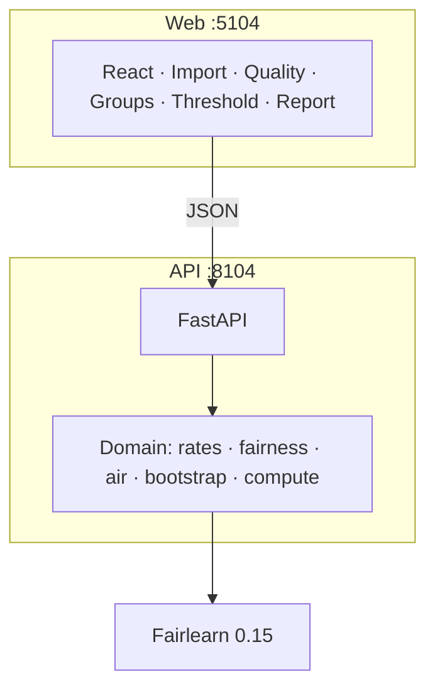

<a id="readme-top"></a>

<p align="center">
  
</p>

# FairHire Audit

Local workstation for auditing hiring-model **evaluation tables**: confusion counts, Fairlearn group disparities, adverse impact ratio (AIR / 4/5ths) with contingency tables, seeded bootstrap intervals, and a score-gated Threshold Lab. Accent `#2563EB`. Ports **8104** (API) / **5104** (web).

It is an audit tool, not a hiring decision engine. It does not claim bias-free status or legal certification.

[](https://github.com/hasanhuseyinyetkiner/fairhire-audit/actions/workflows/ci.yml)
[](LICENSE)

<p align="center">
  <picture>
    <source media="(prefers-color-scheme: dark)" srcset="docs/screenshots/group-disparities-dark.png">
    
  </picture>
</p>

---

## For HR and talent leaders

| Question | What this tool gives you |
| --- | --- |
| **Do selection or error rates differ by group?** | Group rates, adverse impact ratio and contingency tables sit side by side. |
| **How certain is that difference?** | Seeded bootstrap intervals, Fisher exact tests, and undefined values where a group is too small. |
| **What happens at another threshold?** | Threshold Lab recomputes live. It explores trade-offs, it does not approve anyone. |
| **What it is not** | Not a decision engine, not a bias-free claim, not legal certification. The 4/5ths ratio is descriptive. |

## Why it exists

Overall accuracy can look fine while group false-positive and false-negative rates diverge. Reviewers need transparent counts, defined rates (undefined when denominators are empty), and uncertainty — without a black-box “fairness score.”

**Users:** ML / people-analytics engineers with authorized or synthetic evaluation extracts.

---

## Capabilities

| Capability | Status |
| --- | --- |
| CSV / Parquet upload (size-capped; Parquet via `pyarrow`) | Shipped |
| Column mapping + score semantics gate | Shipped |
| Overall quality + Fairlearn group rates + DP / EO / EqOdds | Shipped |
| AIR (selection-rate ratio) / 4/5ths flag + 2×2 contingency + Fisher exact | Shipped |
| Small-*n* suppression + seeded bootstrap CIs (including AIR) | Shipped |
| Threshold Lab (live slider) + HTML/JSON report | Shipped |
| Methodology version + null≠0 / CI-width copy in meta + Threshold Lab | Shipped |
| Playwright E2E (import → groups → threshold network-fail → report) + CI `e2e` job | Shipped |
| Intersection toggle (cell cap 200) | Shipped |
| Cascade delete + retention purge | Shipped |
| Side-by-side two-model comparison UI | Planned (domain deltas exist) |
| Docker Compose local smoke | **BLOCKED** on hosts without Docker (CI job still present) |

---

## Architecture



React + Vite + TypeScript frontend; FastAPI + SQLAlchemy backend; Fairlearn / NumPy / SciPy / sklearn. SQLite demo or Postgres (CI). Details: [`docs/ARCHITECTURE.md`](docs/ARCHITECTURE.md).

---

## Quick start

**Prerequisites:** Python 3.12 (`uv`), Node 24 + pnpm.

```powershell
# API → http://127.0.0.1:8104
uv sync
uv run python -m app

# Web → http://127.0.0.1:5104  (second terminal)
cd frontend
pnpm install
pnpm dev
```

| Service | URL |
| --- | --- |
| Web | http://127.0.0.1:5104 |
| OpenAPI | http://127.0.0.1:8104/docs |
| Health / ready | http://127.0.0.1:8104/health · `/ready` |

Copy [`.env.example`](.env.example) only for overrides. Defaults: loopback bind, SQLite `./data/fairhire.db`, bootstrap seed `20261020`. Non-loopback bind requires `FAIRHIRE_ALLOW_NETWORK_BIND=true`.

---

## 60-second demo

1. Start API + web; open http://127.0.0.1:5104.
2. **Import** → generate **Similar accuracy, different error rates** (204 synthetic rows).
3. Map columns (declare `score` as `probability` for Threshold Lab) → **Run audit**.
4. **Model quality** — CM TN/FP/FN/TP = **91 / 11 / 31 / 71**.
5. **Group disparities** — matched accuracy, diverging FPR/FNR; AIR for `group_b`/`group_a` ≈ **0.60** with contingency table; `group_c` suppressed.
6. **Threshold lab** — move the slider; metrics and AIR update live.
7. **Audit report** — download HTML/JSON (includes “cannot conclude”).

Playwright: `frontend/e2e/workflow.spec.ts` (includes Threshold Lab + network-fail + a11y smoke).

---

## Current status

- Threshold Lab stale/error UX covered by unit + Playwright network abort path.
- Explainability: `GET /api/meta` exposes `methodology_version`, `ci_meaning`, `null_not_zero`, `cmh_available: false`.
- Measured `compute_analysis` baseline: [`docs/PERFORMANCE_BASELINE.md`](docs/PERFORMANCE_BASELINE.md).
- Local Docker Compose: **BLOCKED** (Docker not installed on this workstation).

---

## Method notes

- **Undefined ≠ zero.** Empty denominators and small groups return `null` + reason; JSON never emits NaN for AIR.
- **Fairlearn dual-check.** Count-based selection / TPR / FPR / FNR must match `MetricFrame` on eligible groups.
- **AIR / 4/5ths.** Focal selection rate ÷ reference (highest eligible selection rate). The 0.80 flag is descriptive only.
- **Bootstrap.** Sampling unit = row; percentile 2.5 / 97.5; default *B* = 1000, seed `20261020`. CI width = upper − lower under that procedure.
- **Score gate.** Threshold Lab opens only after `probability` (values in \[0, 1\]) or `ranking_score`.
- **CMH.** Not implemented.

Full formulas: [`docs/MODEL_CARD.md`](docs/MODEL_CARD.md). Verified commands: [`docs/METRICS.md`](docs/METRICS.md). Provenance: [`docs/EVALUATION.md`](docs/EVALUATION.md).

---

## API (implemented)

| Method | Path |
| --- | --- |
| `GET` | `/health`, `/ready`, `/api/meta` |
| `GET` / `POST` | `/api/datasets`, `/api/datasets/synthetic` |
| `POST` | `/api/datasets/{id}/mapping`, `/api/audits` |
| `GET` | `/api/audits/{id}`, `/groups`, `/report.html`, `/report.json` |
| `POST` | `/api/audits/{id}/threshold-scenarios` |
| `DELETE` | `/api/datasets/{id}` (cascade) |

`GET /api/meta` returns `"decision_engine": false`.

---

## Testing

```powershell
uv run ruff check app tests
uv run pytest -q
cd frontend
pnpm lint; pnpm typecheck; pnpm test; pnpm build
```

See [`docs/METRICS.md`](docs/METRICS.md) for the latest verified results.

---

## Security and limitations

- Demo data is **synthetic**. Do not publish real evaluation extracts.
- Loopback by default; **no auth in MVP**.
- Fairness metrics may conflict; observed differences are measurements, not causal or legal conclusions.
- Never claims: bias-free, compliant, certified, or fit for automated employment decisions.
- Threshold Lab network failures surface an alert; stale responses must not overwrite newer results.
- Local Compose smoke requires Docker — **not available on this host**.

Details: [`docs/SECURITY.md`](docs/SECURITY.md), [`docs/LIMITATIONS.md`](docs/LIMITATIONS.md).

---

## Documentation

| Doc | Contents |
| --- | --- |
| [`docs/ARCHITECTURE.md`](docs/ARCHITECTURE.md) | Runtime topology and invariants |
| [`docs/MODEL_CARD.md`](docs/MODEL_CARD.md) | Methodology: formulas, bootstrap, AIR, suppression |
| [`docs/EVALUATION.md`](docs/EVALUATION.md) | Versioned methodology provenance |
| [`docs/PERFORMANCE_BASELINE.md`](docs/PERFORMANCE_BASELINE.md) | Measured recomputation timings |
| [`docs/METRICS.md`](docs/METRICS.md) | Verified commands and fixture numbers |
| [`docs/SECURITY.md`](docs/SECURITY.md) | Loopback / synthetic-data boundaries |
| [`docs/LIMITATIONS.md`](docs/LIMITATIONS.md) | Statistical and product limits |
| [`frontend/README.md`](frontend/README.md) | Web scripts and routes |

License: [MIT](LICENSE).

<p align="right"><a href="#readme-top">↑ back to top</a></p>
