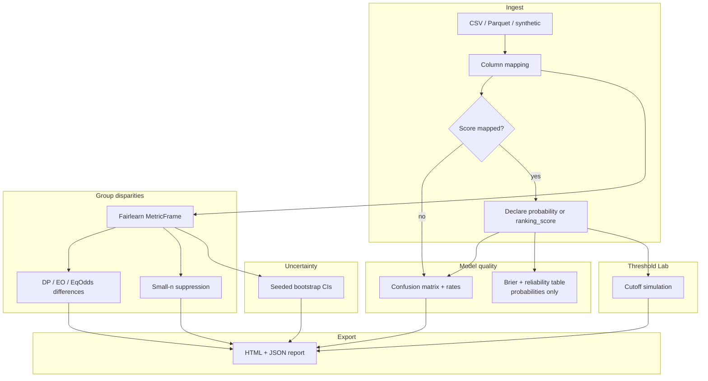

<a id="readme-top"></a>

<div align="center">

<picture>
  <source media="(prefers-color-scheme: dark)" srcset="docs/assets/banner-dark.svg">
  
</picture>

[](https://github.com/hasanhuseyinyetkiner/fairhire-audit/actions/workflows/ci.yml)

**Audit the model. Understand the trade-offs. Show your evidence.**

FairHire Audit is a local web app for inspecting hiring-model *evaluation* tables: confusion matrices, Fairlearn group rates, sample-size flags, seeded bootstrap intervals, and a Threshold Lab that stays locked until score semantics are declared. It is an audit tool, not a hiring decision engine.

[Quick start](#quick-start) · [60-second demo](#60-second-demo) · [What this cannot conclude](#what-this-measures--vs--what-this-cannot-conclude) · [Verification](#verification)

<br/>


</div>

## Why it exists

Hiring models often look fine on overall accuracy while group error rates diverge. Teams need a reproducible way to inspect those trade-offs on authorized or synthetic evaluation data—with denominators, uncertainty, and honest limits written into the report.

**For:** ML / people-analytics engineers and reviewers who already have labeled evaluation rows (`y_true`, `y_pred` or `score`, and permitted group columns).

**Not for:** automated candidate ranking, legal certification, or inferring missing protected attributes.

## Capabilities

| Capability | Status |
| --- | --- |
| CSV / Parquet upload (size-capped; Parquet via pinned `pyarrow`) | Shipped |
| Column mapping + FHA-1 score gate (`probability` / `ranking_score`) | Shipped |
| Overall quality: confusion matrix, accuracy, precision, recall, FPR, FNR | Shipped |
| Fairlearn `MetricFrame` group rates + DP / EO / equalized-odds differences | Shipped |
| Per-group **n**; small-cell suppression (default min *n* = 30) | Shipped |
| Seeded bootstrap CIs (sampling unit, iterations, seed in provenance) | Shipped |
| Threshold Lab (enabled only after declared score semantics) | Shipped |
| Deterministic synthetic profiles (no names / PII) | Shipped |
| HTML + JSON audit report with “cannot conclude” section | Shipped |
| Cascade delete + retention purge (`python -m app.cli purge`) | Shipped |
| Intersectional group explorer UI | Planned |
| Side-by-side two-model comparison on matched rows | Planned |

Accent used in UI and banners: `#2563EB`.

## Metrics pipeline



Undefined rates return `null` with an explicit reason—they are never silently filled with zero.

## Quick start

Native path (verified on Windows 11 with `uv` + pnpm). Copy `.env.example` only if you need overrides.

```powershell
# API → http://127.0.0.1:8104
uv sync
uv run python -m app

# Web → http://127.0.0.1:5104  (second terminal)
cd frontend
pnpm install
pnpm dev
```

| Service | URL |
| --- | --- |
| Web | http://127.0.0.1:5104 |
| OpenAPI | http://127.0.0.1:8104/docs |
| Compose Postgres (CI / optional) | host port `5404` |

Defaults from `.env.example`: `FAIRHIRE_APP_ENV=demo`, loopback bind, SQLite under `./data/fairhire.db`, bootstrap seed `20261020`. The API refuses a non-loopback bind unless `FAIRHIRE_ALLOW_NETWORK_BIND=true`.

Docker Compose is for the CI `compose-smoke` job; use it locally only if Docker is available.

## 60-second demo

With the API and web running and `FAIRHIRE_SEED_DEMO=true` (default in demo):

1. Open http://127.0.0.1:5104 → **Import**.
2. Generate synthetic profile **Similar accuracy, different error rates** (`similar_accuracy_different_errors`).
3. Map columns (prefilled for synthetic) → **Run audit**.
4. **Model quality** — expect confusion matrix cells:

   | | Pred 0 | Pred 1 |
   | --- | ---: | ---: |
   | **True 0** | TN **91** | FP **11** |
   | **True 1** | FN **31** | TP **71** |

5. **Group disparities** — `group_a` / `group_b` each *n* = 100 (same accuracy 0.80, different FPR/FNR); `group_c` *n* = 4 is suppressed (not drawn as zero).
6. **Audit report** → download HTML/JSON. The report includes **What this cannot conclude** and does not contain a “bias-free” certificate.

Path covered by Playwright: `frontend/e2e/workflow.spec.ts`.

## API (implemented)

| Method | Path |
| --- | --- |
| `GET` | `/health`, `/ready`, `/api/meta` |
| `GET` | `/api/synthetic-profiles` |
| `GET` / `POST` | `/api/datasets`, `/api/datasets/synthetic` |
| `GET` / `DELETE` | `/api/datasets/{id}` |
| `GET` | `/api/datasets/{id}/preview`, `/quality` |
| `POST` | `/api/datasets/{id}/mapping` |
| `POST` / `GET` | `/api/audits`, `/api/audits/{id}`, `/groups` |
| `POST` | `/api/audits/{id}/threshold-scenarios` |
| `GET` | `/api/audits/{id}/report.html`, `/report.json` |

`GET /api/meta` returns `"decision_engine": false`.

## What this measures — vs — what this cannot conclude

| Measures | Does **not** conclude |
| --- | --- |
| Confusion matrix and standard classification rates | Legal compliance or regulatory fitness |
| Demographic parity / equal opportunity / equalized odds *differences* (Fairlearn) | A causal reason for any disparity |
| Per-group rates with **n** beside every rate; small-cell suppression | That a missing protected attribute can be inferred |
| Bootstrap CIs (unit, iterations, seed documented) | That a confidence interval “proves” fairness |
| Threshold sensitivity after score semantics are declared | That a simulated cutoff should be deployed |
| Report provenance (versions, assumptions, risks) | A “bias-free”, “compliant”, or certified hiring system |

> [!IMPORTANT]
> Metrics describe the uploaded evaluation table under stated assumptions. They do not authorize employment decisions and must not replace human review.

## Verification

Re-run locally on **2026-10-20** (`uv` + SQLite; see [`docs/METRICS.md`](docs/METRICS.md)):

| Check | Result |
| --- | --- |
| `uv run ruff check app tests` | Pass |
| `uv run pytest -q` | **17 passed, 1 skipped** (`postgres` marker without `TEST_DATABASE_URL`) |
| `pnpm lint` / `typecheck` / `test` / `build` | Pass (**3** Vitest tests) |
| Playwright import → groups → HTML export | **1** passed (`e2e/workflow.spec.ts`) |
| Live API CM spot-check (seeded synthetic) | Hand TP 40+30+1 = **71**; API TP/TN/FP/FN = 71/91/11/31 |

```powershell
uv run ruff check app tests
uv run pytest -q
cd frontend
pnpm lint; pnpm typecheck; pnpm test; pnpm build
pnpm test:e2e
```

CI (`.github/workflows/ci.yml`): backend Ruff + pytest against PostgreSQL; frontend ESLint + `tsc` + Vitest + build; `compose-smoke` (`docker compose up --build -d` → wait `/ready` → `docker compose down -v`).

Screenshots above were captured from a live stack on API `:8104` and web `:5104` via `cd frontend && pnpm screenshots` (also writes dark variants under `docs/screenshots/`).

## Security, privacy, limitations

- Public demo data is **synthetic only**. Do not publish uploaded evaluation files, SQLite DBs, or report exports.
- Deleting a dataset cascades to runs, metrics, intervals, scenarios, reports, and stored files.
- Loopback bind by default; retention purge honors `FAIRHIRE_DATA_RETENTION_DAYS`.
- Do not log raw evaluation rows or sensitive attribute values.
- Fairness criteria can conflict; selection effects, label bias, and base-rate differences are out of scope for causal claims.

GitHub About / topics: [`docs/GITHUB_METADATA.md`](docs/GITHUB_METADATA.md).  
Measured notes: [`docs/METRICS.md`](docs/METRICS.md).

License: pending owner decision.

<p align="right"><a href="#readme-top">↑ back to top</a></p>
