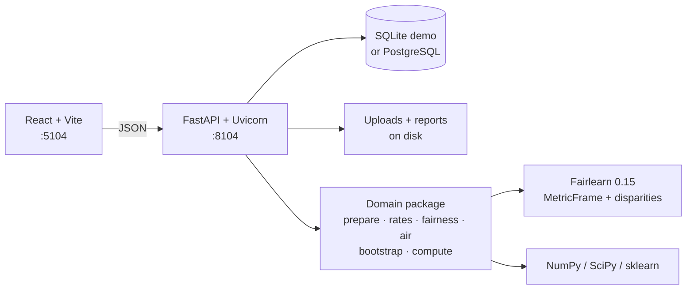
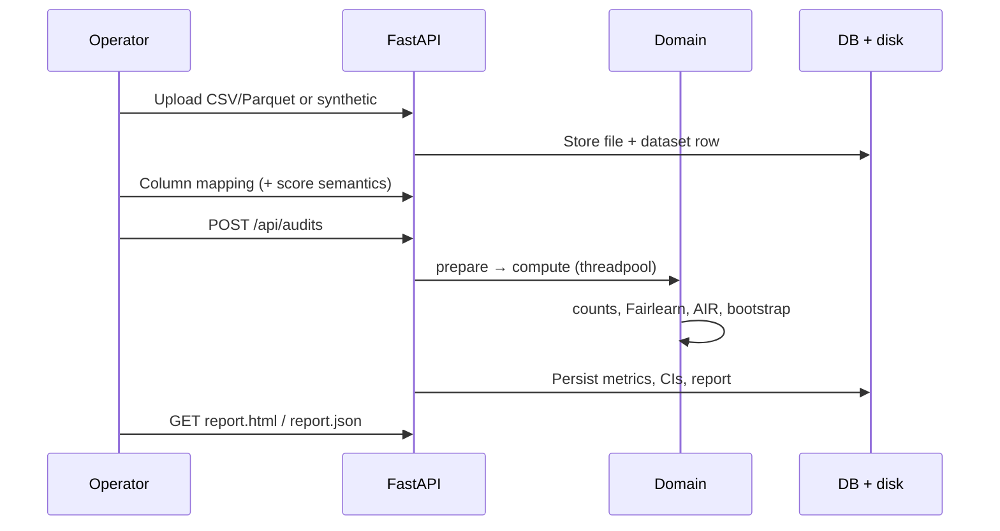

# Architecture

FairHire Audit is a local FastAPI + React application that turns an evaluation table into overall quality metrics, Fairlearn group disparities, AIR / 4/5ths with contingency tables, seeded bootstrap intervals, optional threshold simulations, and a downloadable HTML/JSON report.

## Runtime topology

Native demo defaults: SQLite under `./data/fairhire.db`, loopback bind, ports **8104** / **5104**. Compose (CI / optional) adds Postgres on host port **5404**.

## Layering

| Layer | Responsibility | Key modules |
| --- | --- | --- |
| HTTP | Validation, CORS, health/ready, threadpool offload | `app/api.py`, `app/main.py` |
| Services | Dataset CRUD, audit lifecycle, seed, purge, storage | `app/services/*` |
| Domain | Pure analysis — no FastAPI imports | `app/domain/*` |
| Persistence | SQLAlchemy 2 models + Alembic | `app/models.py`, `alembic/` |

Domain algorithms stay independent of transport so golden tests can call `prepare_frame` → `compute_analysis` without spinning the server.

## Audit data flow

Long bootstrap work runs via `run_in_threadpool`. Runs have `status` + `heartbeat_at`; a startup reaper marks stale `RUNNING` rows `FAILED`.

## Storage model (logical)

- **Dataset** + **ColumnMapping** — source table and declared roles (`y_true`, `y_pred` / `score`, sensitive columns, weights).
- **AuditRun** — seed, iteration counts, `small_group_min_n`, status.
- **AuditMetric** / **GroupMetric** / **ConfidenceInterval** / **ThresholdScenario** — persisted analysis.
- **AuditReport** — HTML + JSON artifacts with assumptions and “cannot conclude” text.

Cascade delete removes derived rows and files when a dataset is deleted.

## Failure and honesty boundaries

- Mapping errors return field-level validation messages (bad probabilities, missing `y_pred` for ranking scores, etc.).
- Undefined rates and suppressed groups are first-class payloads, not charting accidents.
- `/api/meta` advertises `"decision_engine": false`.
- Non-loopback binds refuse to start unless explicitly opted in.

Deeper statistical rationale: [`ENGINEERING_DECISIONS.md`](ENGINEERING_DECISIONS.md). Methodology: [`MODEL_CARD.md`](MODEL_CARD.md). Verification: [`METRICS.md`](METRICS.md). Gaps: [`LIMITATIONS.md`](LIMITATIONS.md). Security: [`SECURITY.md`](SECURITY.md).
